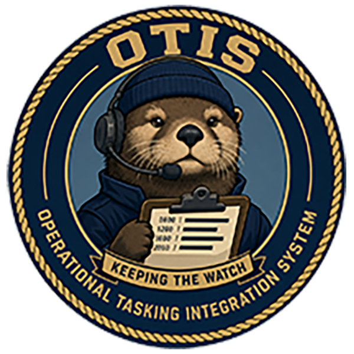

<p align="center">
  
</p>

<h1 align="center">OTIS</h1>
<p align="center"><strong>Operational Tasking Integration System · Keeping the Watch</strong></p>

OTIS turns formatted naval messages into searchable tasking and a consolidated
schedule, helping watchstanders find what matters to their command and trace it
back to the source.

Built by the **Parse Command** team at **FleetHacker2026**, a **Task Force Hopper
Hackathon Event**.

[View the briefing](https://fleethacker.github.io/OTIS/) ·
[Documentation](docs/README.md) · [Architecture](docs/integration/architecture.md) ·
[Operations](docs/integration/combined-stack.md)

## Capabilities

- **Monitor an inbox:** continuously ingest SMTP-delivered messages over IMAP,
  retain original email, deduplicate message bodies, and retry interrupted work.
- **Parse operational tasking:** extract activities, frequency plans, crypto
  changeover times, reporting requirements, locations, and source points of contact
  from supported OPTASK layouts.
- **Search message traffic:** combine keyword and local semantic search through
  OpenSearch, with filters for command, message type, originator, and issue date.
- **Build the watch picture:** browse day, week, and month schedules in Zulu or
  local time; keep incomplete times and unresolved facts visible for review.
- **Review the evidence:** inspect raw messages, structured source sets, extraction
  evidence, and processing history from the message reader.
- **Prepare a response:** generate and privately save acknowledgement drafts for
  review. Drafts remain unsent; SMTP response delivery is not implemented.
- **Track new traffic:** receive in-app notifications for newly published messages
  and intake/publication failures and recoveries.
- **Run locally:** React UI, Rust application/parser server, and OpenSearch with
  CPU-only embeddings. Prepared runtime assets support disconnected operation;
  optional Keycloak OIDC provides shared-deployment authentication.

## Quick start

Use **Docker Compose 2.24.4+**, **Python 3.9+**, and at least **4 GB of Docker
memory**. The committed native dependency lock is validated on **Linux ARM64**;
other architectures need the preparation described in the
[search runbook](backend/search/README.md). Linux hosts also need
`vm.max_map_count` set to at least `262144`.

From the repository root, prepare the local search assets while connected:

```sh
python3 -m venv /tmp/otis-search-venv
/tmp/otis-search-venv/bin/pip install -r backend/search/requirements.lock
/tmp/otis-search-venv/bin/python backend/search/prepare_assets.py
python3 backend/search/prepare_native.py --arch arm64
```

Start the demo mailbox, build the application stack, and provision the local model:

```sh
docker compose -f demo/docker-compose.yml up -d --wait --wait-timeout 180
docker compose up --build -d --wait --wait-timeout 180
/tmp/otis-search-venv/bin/python backend/search/deploy.py
curl --fail http://localhost:8080/api/health
```

Open **[OTIS at localhost:8080](http://localhost:8080)**. The default profile uses
local demo authentication. OpenSearch is available at `http://localhost:9200`;
SMTP and IMAP use loopback ports `1025` and `1143`. This profile uses plaintext
mail and disables OpenSearch authentication/TLS for local development.

Send a UTF-8 test message whose body starts with `MSGID`:

```sh
python3 demo/mail.py send /absolute/path/to/message.txt \
  --subject 'SUBJ: DEMO OPTASK exercise'
python3 demo/mail.py inbox --limit 20
```

Messages are ingested automatically. For historical examples, navigate the
calendar to the source message dates. See the [mail demo guide](demo/README.md)
for mailbox details and the [test-data guide](test-data/README.md) for sample
provenance and usage. Startup does not automatically send sample messages.

Stop the application with `docker compose down`, then stop the mailbox with
`docker compose -f demo/docker-compose.yml down`. Both retain persistent volumes.
For offline transfers, restarts, or existing-state migration, follow the
[stack runbook](docs/integration/combined-stack.md) and
[settings and migration guide](docs/integration/settings-oidc.md).

## Supported OPTASK messages

Example-based regression coverage includes **AAW, ASUW, ASW, COMMS, COP-CTP, EW,
GENERAL, IM, LINK, LINK ID SUPP, MCM, MINING, NUC, and RAS**. See the
[Rust backend guide](backend/README.md) for parser implementation and verification.

Support applies to the tested layouts, rather than every USMTF edition or message
type. Extracted tasking requires human review, and missing or uncertain values
remain explicit. Production Outlook/Exchange authentication and TLS integration
require separate implementation and acceptance; the demo exercises SMTP/IMAP.

## Repository guide

| Path | Contents |
| --- | --- |
| [`apps/watch-desk/`](apps/watch-desk/) | OTIS React UI, branding, and original Go reference source |
| [`backend/`](backend/) | Rust parser SDK, application server, durable IMAP intake, and local search tooling |
| [`demo/`](demo/) | SMTP/IMAP demo mailbox and message helper |
| [`test-data/`](test-data/) | Shared test messages and provenance |
| [`docs/`](docs/) | Data contracts, schemas, search mappings, and operating guides |
| [`site/`](site/) | GitHub Pages briefing |

Parser contributors should start with the [parsed-message ICD](docs/ICD.md)
and [JSON Schemas](docs/schemas/README.md). Operational acceptance examples and
manual-derived knowledge remain outside Git; see the backend and test-data guides.

## UDS deployment

Issue #9 adds an ARM64 [Zarf/UDS packaging workflow](deploy/uds/README.md) with
native Keycloak OIDC, verified IMAP TLS and explicit retained storage/mesh policy.
See the [validation record](deploy/uds/VALIDATION.md) for tested revisions and
the remaining native-profile migration, browser and recovery acceptance gate.
