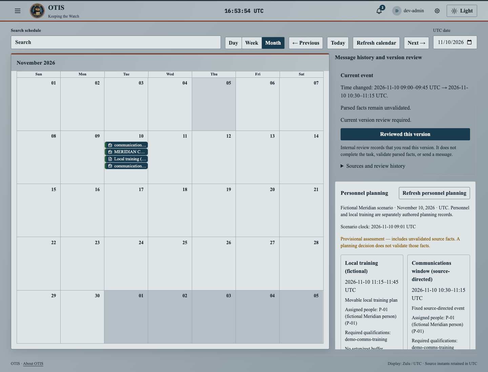

# ANCHOR and PB4T calendar integration

The branch `codex/anchor-pb4t-calendar` was initially based on `aabfacb8403df000937e4ad4e0d49d466525e791`
from `main`, fetched November 5, 2026. All 728 tracked baseline files matched
the supplied `OTIS-main-2` snapshot. Feature code originates in the completed
Agent 1–3 prototype; its earlier test results are not evidence for this branch.

Before publication, the branch was rebased onto `665d36ed8c467a5d4fc95ee961d6e6ce551aa285`,
including the newly merged OTIS logo and layered architecture documentation.
The full UI suite, direct typecheck, lint and bundled build passed again after
that update.

## Behavior and scope

The first integration uses fictional command Meridian on **November 10, 2026 UTC**:

1. A parsed original message places a communications event at 09:00–09:45 and
   creates an assigned review task.
2. An explicitly linked amendment replaces that event with 10:30–11:15. The
   calendar and reader show the current version; prior source evidence and
   review history remain available. The new version requires fresh review.
3. P-01 also has local training at 10:45–11:15. PB4T explains that collision
   and proposes the earliest permitted alternative, 11:15–11:45.
4. An authorized coordinator accepts or rejects the proposal. Acceptance changes
   the saved local training plan; rejection leaves its original time intact.
   Changes to message, roster or plan versions require recalculation.
5. A linked cancellation removes the communications event from active calendar
   views. The accepted local training and decision history remain.

Saved local training appears as an explicitly labelled local-plan block in day,
week and month views. Its link opens planning history rather than inventing a
source message. The panel and blocks respect selected commands and dates and
are absent from legacy data. Calendar and workflow controls scroll independently;
narrow screens stack them without collapsing the calendar.

This is the bounded subset described in the priority integration guide, not the
entire ANCHOR or PB4T challenge statement. Amendment/cancellation relationships
are explicit declarations; arbitrary incoming text does not establish authority.
Personnel, qualification, availability and movement rules are authored scenario
inputs. Source-derived calculations remain provisional. External messaging,
official release, operational rosters, autonomous departmental negotiation,
global optimization and broad SFTRM/fatigue checks are outside this integration.



## Architecture

The existing Rust server, native sessions, OpenSearch state store and React
calendar remain the application path. Work, lineage and planning use one
version-checked `priority_workflow` aggregate. A decision atomically rechecks
the current message and planning inputs; stale writes return a conflict.
Private drafts, original message bytes and parsed facts remain separate.

Only required account, responsibility and source-scope helpers are carried over;
the earlier full watch-planning branch is not imported. Current OTIS branding,
native authentication, UDS rules and parser contracts are preserved. A fresh
query client follows each native session scope, preventing reuse of cached data
from a previous access scope. Notification groups, members, counts and read
actions also enforce source access.

The [shared contract](../planning/priority-integration-contract.md) documents
identities, authorization and `/api/v1/work`, `/api/v1/anchor` and
`/api/v1/planning` operations. Source fixtures and replay instructions live in
`backend/config/priority-1`, `priority-2` and `priority-3`.

## Validation

Results below are from this current-main integration, using dedicated real
OpenSearch and local application instances. No shared deployment data was reset.
Counts are retained in [the validation summary](anchor-pb4t-validation.json).

| Check | Result |
| --- | --- |
| Rust workspace | 119 passed; 48 optional external/service/generated checks ignored. |
| Live work, ANCHOR, PB4T and notification-scope tests | 14 passed. |
| Explicit intake routing | 4 passed, including 2 real-storage checks. |
| Full UI suite | 147 passed, including account-change and scope-narrowing cache regressions. |
| Calendar/ANCHOR after layout changes | 28 passed after sidebar changes; 23 passed after month-title adjustment. |
| Clippy, Rust formatting and generated types | Passed. |
| Direct protected UI typecheck, lint/format and bundled build | Passed; routes regenerated by the unchanged builder. |
| Direct Go tests | Passed; existing HTTP tests required local listener access. |
| All-stage combined HTTP replay | 46 checks passed. |
| Rendered Chrome calendar acceptance | 5 flows passed, no page errors: conflict, reject/reload, accept/reload, all calendar views, date/command filtering. |
| Narrow-screen month view | Passed: the overflow control opens the accepted 11:15 local plan. |
| Final cancellation, permissions and restart | 20 cancellation, 11 permission/schema and 14 restart checks passed. |
| Canonical Ark-managed checks | Unverified: `ark run job build` could not start because the compatible CLI is absent. Direct checks are not Ark-managed gate results. |

Review found and fixed stale UI caches after access changes and notification
metadata bypassing source scope; both have regression coverage and independent
follow-up review. Browser testing caught month-view collapse below tall workflow
panels; the calendar/sidebar layout fixes it. Test timing is software execution,
not watchstander performance. Live IMAP transport, operational rosters, official
message authority and human acceptance were not validated by this run.

## Replaying the demonstration

Follow source staging instructions in [priority 1](../../backend/config/priority-1/README.md)
and [priority 2](../../backend/config/priority-2/README.md). Use a dedicated search
instance because canonical aliases are fixed, explicit local-demo login, a new
hidden state index and the existing server with verified tokenizer assets.
The [priority 3 guide](../../backend/config/priority-3/README.md) covers the full
sequence. With fresh state and source messages published, this run used:

```sh
python3 backend/tools/replay_priority3.py --base-url http://127.0.0.1:18440 --demo-login --stage conflict
PRIORITY_3_BASE_URL=http://127.0.0.1:18440 node scripts/priority-3-browser.cjs
python3 backend/tools/replay_priority3.py --base-url http://127.0.0.1:18440 --demo-login --stage cancel
python3 backend/tools/replay_priority3.py --base-url http://127.0.0.1:18440 --demo-login --stage verify
```

The browser harness requires prepared Playwright and Chrome. `conflict` requires
fresh state and never rewinds/deletes a progressed scenario. The helper also
supports documented HTTP acceptance stages. Review remains separate from task
completion and sends no message.
