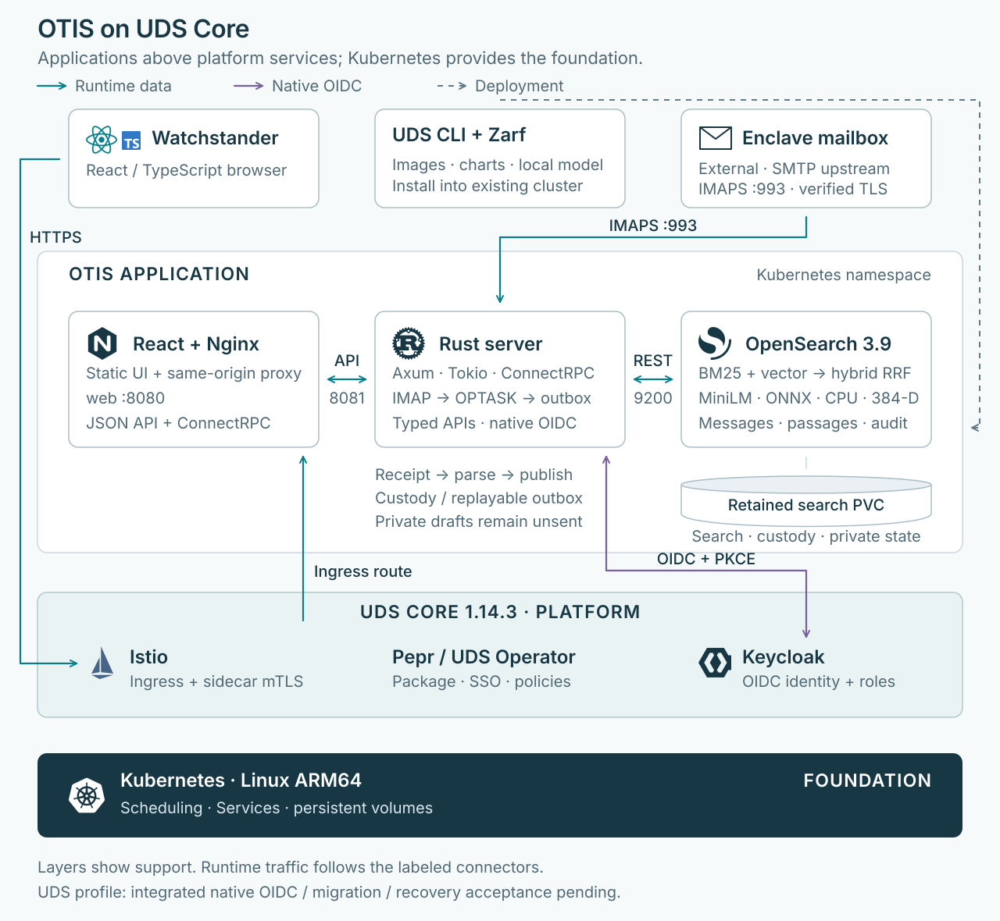
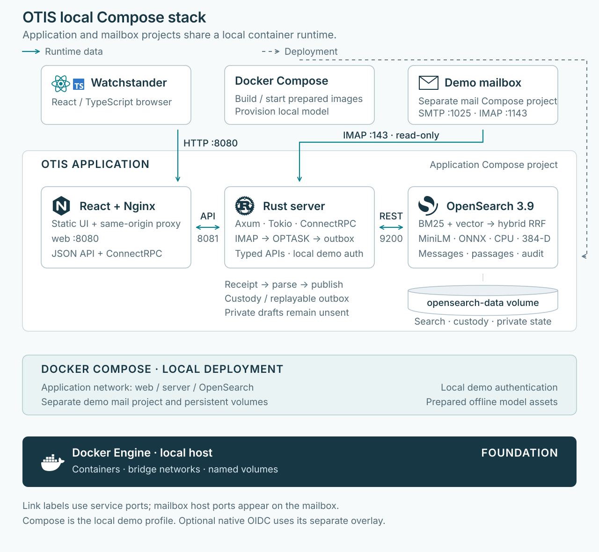

# OTIS architecture

OTIS turns SMTP-delivered naval messages into searchable tasking, a calendar and
source evidence. The application is React/TypeScript, Nginx, a Rust server and
OpenSearch with local CPU embeddings. Docker Compose and UDS deploy the same
application responsibilities on different foundations.

## UDS: read the platform from the bottom up

| Layer, bottom to top | Responsibility |
| --- | --- |
| Kubernetes on Linux ARM64 | Runs Pods and Services, schedules workloads and attaches persistent storage. The pinned local validation environment uses K3d/K3s. |
| UDS Core 1.14.3, base + identity | Provides Istio ingress and service mesh, Pepr/UDS Operator and Keycloak. The OTIS UDS Package declares exposure, allowed traffic and SSO registration. |
| OTIS workloads | Nginx serves the React UI and proxies application calls. Rust owns APIs, native OIDC sessions, intake, parsing and publication. OpenSearch owns search, local MiniLM inference and durable application data. |

The layers show which platform supports each workload. Runtime traffic follows
the labeled connections: browser HTTPS reaches the Istio ingress, then Nginx
`web:8080`, Rust `server:8081` and OpenSearch `:9200`. UDS Core is not an extra
application RPC hop. Its Istio sidecars secure workload traffic with STRICT
mTLS and receiver policies; OpenSearch has no public ingress.

Keycloak is part of the UDS identity layer. UDS registers the confidential client;
Rust performs authorization-code OIDC with PKCE and owns the browser's opaque
session cookie. OTIS does not use the platform's Authservice for authentication.
The mailbox stays outside the application bundle; Rust reads it using
hostname/CA-verified implicit TLS IMAP, normally on port `993`.

The retained OpenSearch PVC holds published search indices, hidden custody and
hidden private state. These indices are logical separation within the same
storage, not separate backup or authorization boundaries. Kubernetes supplies
the configured storage; old SQLite claims remain migration/rollback sources.

UDS CLI, Zarf and Helm deliver images, charts and bundled model assets into an
existing compatible Core cluster. That installation path is separate from
runtime requests. The OTIS bundle does not create the cluster or install a
mailbox. See the [UDS runbook](../../deploy/uds/README.md) for deployment inputs.

## Compose: the local demo foundation

Docker Compose runs `web`, `server` and `opensearch` on an application network.
There is no Kubernetes or UDS Core layer in this profile. The browser reaches
Nginx at `localhost:8080`; Rust is internal on port `8081`. A separate
`demo/` Compose project supplies docker-mailserver and independent mail volumes.
SMTP delivery uses loopback `:1025`; Rust connects to `mailserver:143` for
read-only plaintext demo IMAP. OpenSearch persists to `opensearch-data`.

The default profile uses local-demo authentication. An optional OIDC overlay
integrates an already provisioned local Keycloak issuer; it does not install UDS
Core. Follow the [combined-stack runbook](combined-stack.md) for startup and
[the identity contract](settings-oidc.md) for the OIDC overlay.

## Data flows shared by both profiles

1. **Receive and retain.** Rust reads IMAP without changing mailbox flags. It
   retains original email bytes in hidden OpenSearch custody before advancing
   the cursor, then bounds MIME decoding and deduplicates decoded bodies.
2. **Parse and publish.** The transport-independent Rust parser SDK dispatches
   to compiled OPTASK contributors and validates the ICD 1.1.0 result. Replayable
   outbox work publishes canonical messages, narrative passages and immutable
   audit records; individual bulk results must succeed before acknowledgement.
3. **Search and read.** OpenSearch runs the pinned ONNX MiniLM model locally on
   CPU. BM25 and vector retrieval combine through RRF for hybrid search. React
   calls typed Rust JSON APIs and generated ConnectRPC services through Nginx;
   Rust controls search templates and returns calendar, message and evidence
   views. Browser clients do not query OpenSearch directly.
4. **Keep private work.** Rust scopes drafts, preferences and notification read
   state to the authenticated owner in hidden OpenSearch state. Acknowledgement
   drafts remain unsent; there is no SMTP response-delivery flow.

## Current status and boundaries

The diagrams describe the implemented application and packaged UDS profile,
not acceptance of a running deployment. The [UDS validation record](../../deploy/uds/VALIDATION.md)
distinguishes historical SQLite/Authservice live tests from the current native
OIDC/OpenSearch architecture. Fresh integrated identity, migration, intake/search
and recovery acceptance remains required. Compose remains the supported local
demo workflow.

Prepared images and model/native assets allow runtime operation without public
downloads; enclave egress enforcement remains a deployment responsibility. The
UDS mail adapter supports verified implicit TLS with password LOGIN, not
STARTTLS or OAuth/XOAUTH2. Neither diagram establishes operational capacity,
high availability or an automatic retention policy; the agreed 365-day issue-time
retention still needs deployment policy rollout.

## Repository source map

| Concern | Source of truth |
| --- | --- |
| Local services, networks and volumes | [`docker-compose.yml`](../../docker-compose.yml), [`demo/docker-compose.yml`](../../demo/docker-compose.yml) |
| Nginx application routing | [Compose proxy](../../apps/watch-desk/deploy/nginx.conf), [UDS proxy](../../deploy/uds/charts/ui/nginx.conf) |
| Browser/Rust presentation boundary | [Rust application API](rust-application-api.md), [`api.rs`](../../backend/crates/parse-command-server/src/api.rs), [`rpc.rs`](../../backend/crates/parse-command-server/src/rpc.rs) |
| Intake, parser and canonical data | [Intake contract](../../backend/INTAKE.md), [parser SDK](../../backend/README.md), [ICD 1.1.0](../ICD.md) |
| Publication and local inference | [`publisher.rs`](../../backend/crates/parse-command-server/src/publisher.rs), [search runbook](../../backend/search/README.md) |
| Identity, ownership and migration | [Settings/OIDC contract](settings-oidc.md), [`auth.rs`](../../backend/crates/parse-command-server/src/auth.rs) |
| UDS exposure, mesh and SSO policy | [`Package` and Istio policies](../../deploy/uds/charts/config/templates/package.yaml) |
| UDS workloads and retained storage | [Server chart](../../deploy/uds/charts/server/templates/workload.yaml), [OpenSearch chart](../../deploy/uds/charts/opensearch/templates/workload.yaml) |
| UDS delivery, pins and acceptance | [Bundle](../../deploy/uds/bundle/uds-bundle.yaml), [version pins](../../deploy/uds/versions.json), [ADR 0002](../decisions/0002-uds-arm64-deployment.md), [validation record](../../deploy/uds/VALIDATION.md) |
