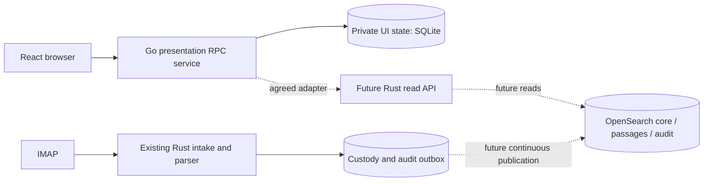

# Watch Desk source import and integration analysis

Date: 2026-11-04. Branch: `ark-export-integration`. Rebased onto merged PR #2 at
`77d5267fe29589bb99a9ce3fc5020e37c4381ffb`.

## Outcome and scope

The Ark export is extracted into `apps/watch-desk/`. The existing Rust workspace
and shared contracts retain their paths. Docker Compose packages the React UI
and its Go service as one `web` container alongside the existing OpenSearch
service. The team's later Go-versus-Rust decision is recorded in
[ADR 0001](../decisions/0001-retain-watch-desk-go-service.md).

**The running schedule source still reads SQLite.** This import does not
implement an OpenSearch schedule adapter. Current `main` supplies the OPTASK
contribution, durable IMAP worker, custody/outbox journal and ICD 1.1.0 geographic
fields. The optional [`compose.intake.yml`](../../compose.intake.yml) overlay
runs those services alongside the UI and OpenSearch; see the
[combined-stack guide](combined-stack.md). Continuous index delivery, the Rust
read API, UI mapping, embeddings and retention remain follow-up work. Service
health is independent of those missing domain capabilities.

## Original export and review coverage

The original archive contains **346 files**, totaling **2,270,446 uncompressed
bytes**. Every archive member was checked for a safe relative regular-file path,
read as UTF-8, hashed, classified, and mapped to its destination in
[the complete file inventory](ark-export-files.tsv). JSON inputs were parsed;
`ui/tsconfig.json` is intentionally JSONC rather than strict JSON. The
[provenance summary](ark-export-provenance.json) records the archive SHA-256 and
category totals. Regenerate these with:

```sh
python3 scripts/inventory-ark-export.py workspace-826e22c7a82b67c8aa5cbec8-source-final.tar.gz
```

The integration review follows the application entry point, both instruction
hierarchies, approved context, build scripts and locks, Go RPCs and persistence
schemas, UI routing/data/time/privacy boundaries, and regression suites. Generated
code and bundled framework files were inventoried and reviewed at their public
boundaries; this is not a line-by-line security certification of their internals.
Historical validation claims in the export remain historical claims.

| Export group | Files | Analysis and treatment |
| --- | ---: | --- |
| Application Go | 11 | RPC registration, source conversion, drafts/preparation, evidence validation and errors |
| Application React | 35 | Calendar/message experiences, display time, ship filtering, private sessions, notifications and routing |
| Protobuf sources / ENT schemas | 4 / 7 | Editable presentation and persistence contracts; preserve codegen roots |
| Generated outputs | 76 | ENT, Go/TS protobuf and Connect clients, generated routes; retain, never hand-edit |
| Go / React framework | 63 / 29 | Startup, SQLite, auth, jobs, RPC/provider primitives; bundled read-only |
| Framework tooling | 35 | Protected build/check/journey/codegen assets; preserve originals |
| Tests / test inputs / seed | 54 / 3 / 1 | Generic regression coverage plus isolated reference fixtures and fictional startup seed |
| Approved context / guidance / docs / build inputs | 7 / 3 / 5 / 13 | Preserve provenance, design history, instructions, pinned module/workspace inputs and license |

The archive's manifest identifies source revision
`ce3c03c45f94ca17ddc4214305e6f96f9611c891`, independently pinned state revision
`d65e36278bf5c170ebd1fa17676fed178a88fb64`, and approved context. It lists twenty
omitted/replaced files, including deployment inputs, internal Ark state and ENT
generator support. Source export does not include a live database or credentials.
The archive itself is retained locally and ignored by Git.

## Repository structure and ownership

```text
Parse-Command/
  AGENTS.md, CLAUDE.md       combined repository guidance
  docker-compose.yml        local Go/React + OpenSearch stack
  compose.intake.yml         optional combined mail/Rust intake overlay
  .env.example              optional local port/auth overrides
  backend/                  Rust SDK, OPTASK contribution and durable IMAP worker
  demo/                     SMTP/IMAP demo server and local helper
  apps/watch-desk/          self-contained imported application
    AGENTS.md, CLAUDE.md     original public app guidance
    .ark-handoff/            original manifest and approved context
    Dockerfile              UI bundle → Go binary → nonroot runtime
    cmd/healthcheck/         shell-free container liveness probe
    internal/service/       Go source reads, private drafts/preparation
    internal/data/          clearly fictional startup seed
    ent/schema/, proto/     editable persistence and RPC definitions
    ent/, gen/              generated Go implementations
    ui/src/                 React pages, components, generated clients
    ui/tests/               isolated browser journeys
    ark/                    original bundled framework and pipeline
    scripts/                app-owned portable build helpers
    docs/                   original app integration and handoff documentation
  docs/                     canonical ICD, schemas, mappings and planning
    decisions/              current team architecture decisions
    integration/            this analysis, inventory and validation record
  scripts/                  inventory and local reference-fixture restoration
  .pdlc-docs/                original larger-project product context
```

Keeping the Go app's relative paths intact preserves `go.mod`'s local framework
replacement, Bun workspace links, Go asset embedding, generated import paths,
Buf roots, framework seed/roles paths and journey fixture lookup. Flattening only
`ui/` into the root would break several of these assumptions and strand the RPC
and private-persistence features that the UI already uses.

## What the imported application actually implements

- `main.go` embeds the built UI, creates the ENT schema, and registers services
  through Ark. One binary serves SPA routes and same-origin ConnectRPC requests.
- `SourceDataService.ReadSchedules` fetches all SQLite messages with events and
  revisions. `ScheduleSource.Read(ctx)` is its explicit replacement boundary.
  Reads fail visibly; they never fall back to examples after a failure.
- The fictional seed has five messages, eight events and one revision. November
  2026 dates are fixed. Seed-on-empty-table behavior is not import/update logic.
- Calendar supports Day/Week/Month, UTC or browser-local presentation, URL-owned
  navigation/search state, ship selection and source-record return links.
  Only confirmed positive intervals with both timestamps enter the calendar.
- Message records retain optional raw/evidence/structured views and source-owned
  lifecycle. Structured JSON is stored as lossless text; envelope validation
  alone does not establish ICD conformance or operational correctness.
- Draft RPCs scope state by authenticated subject and source message. Structured
  preparation and user-reported activity remain private and unsent. Session
  changes invalidate the UI's separate private cache. Nothing transmits mail.
- Notifications are client-derived and localStorage-backed. Schedule searching
  is local text matching across a full snapshot, not OpenSearch BM25 or hybrid
  retrieval. Summarize remains disabled.

## Contracts that need reconciliation before real data

| Concern | Existing Rust / OpenSearch contract | Imported presentation contract | Integration requirement |
| --- | --- | --- | --- |
| Identity | String message hash, revision, revision-scoped short fact IDs | Numeric DB IDs plus `source_message_id` / `source_event_id` | Explicit stable mapping; retain revision and source links without numeric coercion |
| Schedule | Typed periods, frequencies and activities with unresolved values | `ExtractedEvent` with title/unit/location and confirmed interval | Agree activity-to-event rules; validity periods and arbitrary frequencies do not imply ship events |
| Geography | ICD 1.1.0 optional locations, points/shapes and explicit datum/resolution semantics | Lossless structured JSON and generic additional-field cards | Preserve unknown fields and coordinate precision; geometry is not a confirmed event or ship-ownership assignment |
| Evidence | Separate audit index keyed by message/revision/subject | Raw text and optional one-based line references in snapshot | Authorized evidence retrieval; preserve byte offsets and distinguish unavailable/pending evidence |
| Review | `needs_review`, partial output, review flags | Parsed/updated/needs-review records and confirmed/needs-review events | Explicit translation; parser success alone cannot confirm an operational schedule |
| Freshness | Canonical publication, audit flush, passage enrichment differ | Successful read timestamp and a full snapshot | Preserve upstream revision/freshness and unavailable/degraded states |
| Search | Bounded lexical / semantic / hybrid retrieval is planned | Full-snapshot local substring filters | Agree pagination/filter ordering and actual executed search mode before replacing snapshot search |
| Private state | Canonical audit is source/parser evidence | SQLite private drafts, preparation and user-reported acknowledgement | Keep ownership and transactions separate; never publish draft text to shared audit/source data |
| Security | Markings, command policy, upstream identity remain open | Framework decodes bearer claims supplied by a verified upstream boundary | Shared deployment must verify tokens on every receiver path and enforce agreed data policy |

The imported `ReadSchedules` handler currently has no per-message authorization
check; browser `AuthGate` is presentation, not API enforcement. Private draft RPCs
do require an owner subject. Real source reads must enforce the agreed policy at
the server boundary before exposing operational records. The loopback fictional
Compose profile does not establish this missing authorization behavior.

Current custody and proposed future read/publication path:



The existing UI-integration proposal has the browser talking directly to Rust;
the retained Go service is a transitional change to that proposal. ADR 0001
makes this explicit. Neither the ICD JSON nor the exported protobuf is silently
declared the team's final operational HTTP contract.

The archive's local-only structured reference fixtures describe the earlier
snapshot. They are UI rendering regression inputs, not a regenerated ICD 1.1.0
acceptance corpus. Current schema/type conformance and external OPTASK regression
remain owned by the Rust backend and external fixtures. The app's unknown-field
rendering and lossless JSON storage remain intact; no geographic payload creates
a calendar event implicitly.

## Context precedence and material differences

Both context sets remain in place. Root `AGENTS.md` explains ownership and
points to the nested app/framework guidance. `.ark-handoff/context/` expresses
the UI's approved historical intent; `.pdlc-docs/` and `docs/planning/` retain the
larger system's requirements and proposals. The current user's request governs
the local integration.

- The UI anti-goals exclude implementing a parser. That remains appropriate for
  the Go/React app; the larger Rust project still owns parsing.
- Earlier UI context describes a horizontal UTC-only Gantt. `DESIGN.md` and code
  supersede that with React Big Calendar and optional local-time presentation.
  Import preserves the implemented UI; team acceptance of display policy remains
  necessary for the operational integration.
- Original backend documentation anticipated a future root `ui/`. The actual
  app now lives at `apps/watch-desk/ui/`, because its Go service and build inputs
  are part of the delivered application.
- Runtime airgap is a larger-project requirement. Local Compose bundles assets
  and uses a private bridge with loopback host ports. Connected builds/downloads remain allowed. A full
  operational offline bundle still needs the eventual Rust runtime, selected
  embedding model, bootstrap and lifecycle policies.
- Original source-data docs correctly report that no upstream backend was
  connected at export time. Starting OpenSearch alongside this app does not
  alter that statement.

## Portability fixes and corpus handling

The application Bun lockfile embedded 68 tarball URLs for an Ark-cluster-only
package proxy. They now point at the public npm registry with **all dependency
versions, metadata and integrity hashes preserved**. The protected pipeline
toolchain lock remains byte-for-byte original. Container packaging normalizes
only a disposable copy into `/opt/ark-toolchain/`; its installed tools resolve
through the container's `ark/node_modules` link. This does not weaken or replace
the protected Ark pipeline.

Two archived fixtures contain the fourteen external OPTASK reference payloads:

- `internal/service/testdata/structured-messages.json`
- `ui/tests/journey/fixtures/present-extensible-structured-message-cards.json`

They remain extracted locally, are ignored by Git, and are excluded from Docker
build contexts. Original payload bytes remain in the original archive. A fresh
clone intentionally lacks them; the Go reference-contract test, UI corpus test
and corresponding browser journey explicitly skip when absent. Generic UI tests
still run; per-reference UI cases are registered only when the corpus exists.
Restore only these ignored files
from a separately supplied original archive to run that optional coverage:

```sh
python3 scripts/restore-ark-fixtures.py /absolute/path/to/workspace-source.tar.gz
```

The generator beside those fixtures references omitted `.ark/story-files` state;
it is not a usable importer in a normal clone. Use the restoration helper rather
than recreating private Ark state. Generic synthetic tests and the clearly
labeled fictional startup seed remain part of the source tree.

## Docker Compose operation

From the monorepo root:

```sh
docker compose config --quiet
docker compose up --build -d --wait
```

Open `http://localhost:8080`; local mock authentication uses the `user` identity
by default. The framework role picker is available at `/__ark/mock-login`.
The app uses one origin for UI and API.
OpenSearch is available for local tools at `http://localhost:9200`; container
services use `http://opensearch:9200`. No OpenSearch URL or credential is injected
into browser assets. `.env.example` lists optional overrides; no copy is needed
for defaults.

| Service | Contents | Persistent state | Health |
| --- | --- | --- | --- |
| `web` | Embedded React + Go RPC service; nonroot, read-only root FS | `watch-desk-data` at `/data` | `/api/health` via a small Go probe |
| `opensearch` | Existing pinned OpenSearch 3.9.0 single node | Existing `opensearch-data` volume | Cluster reaches yellow or green |

Compose waits for the OpenSearch healthcheck before starting `web` using
[`service_healthy`](https://docs.docker.com/compose/how-tos/startup-order/).
This is startup ordering; it neither tests the missing data adapter nor makes
the web liveness endpoint a downstream-readiness guarantee.

Both host ports bind to loopback. The application uses an ordinary private bridge;
all assets are bundled and these containers need no runtime registry/CDN access.
This Compose profile supports disconnected operation but does not itself enforce
an enclave firewall or block outbound traffic on a connected host. Enforce that
boundary in the deployment environment. An exclusively `internal: true` network
suppressed published host ports on the tested Docker engine; the ordinary bridge
is necessary for this local profile's host access.
Mock auth and the disabled
OpenSearch security plugin are an isolated local profile. A shared deployment
needs the real verifying identity boundary, TLS and agreed authorization policy;
setting `ARK_MOCK_AUTH=0` alone does not create that boundary.

Allocate at least 4 GB to Docker; Linux hosts need `vm.max_map_count` at least
262144 per the [OpenSearch Docker guide](https://docs.opensearch.org/latest/install-and-configure/install-opensearch/docker/).
No production hardware guarantee is implied by the existing 512 MB JVM heap.

```sh
docker compose logs --tail=100 web opensearch
docker compose stop          # stop processes, retain containers and volumes
docker compose down          # remove stack containers/network, retain volumes
docker compose up -d --wait  # reuse the prepared images and data
```

Do not use `down -v` unless intentionally deleting both persisted datasets.
Changing seeds does not clear existing SQLite rows. For an empty integration
database, use a dedicated volume and mount an explicit empty seed file through
`ARK_SEED_PATH`; do not reuse the fictional database for operational records.

For connected preparation followed by an offline runtime:

```sh
docker compose build web
docker compose pull opensearch
docker save -o /absolute/output/parse-command-images.tar \
  parse-command/watch-desk:local opensearchproject/opensearch:3.9.0
# On the offline host, with this repository and compatible CPU architecture:
docker load -i /absolute/input/parse-command-images.tar
docker compose up --no-build --pull never -d --wait
```

The runtime image contains compiled assets/binaries, CA certificates, and the
fictional seed plus the original license notice; it contains no source archive, external corpus, Bun/npm, Go build
tools or dependency caches. CPU-architecture compatibility must be prepared
explicitly; the local check does not validate every deployment architecture.

## Validation and remaining implementation

See [validation results](validation.md) for actual local outcomes and limits.
With a compatible Ark CLI, run its documented build/unit/check/journey jobs
from `apps/watch-desk/`. The installed CLI must match the export's protected
assets; do not edit those assets to force a newer CLI to accept the project.

Portable container diagnostics are available separately:

```sh
docker build --target go-test -f apps/watch-desk/Dockerfile apps/watch-desk
docker build --target ui-test -f apps/watch-desk/Dockerfile apps/watch-desk
```

These are diagnostics, not an Ark release-validation claim. They intentionally
exclude corpus fixtures just as the runtime packaging does.

Next domain implementation sequence:

1. Agree the Rust read API and Go `ScheduleSource` adapter contract, including
   stable IDs, authorization, revision visibility, evidence and snapshot limits.
2. Extend the existing Rust intake/custody boundary with canonical publication,
   durable audit delivery and the agreed read API outside pure contributor crates.
   The executable already runs through the optional combined Compose overlay;
   do not duplicate its parsing or custody responsibilities in Go.
3. Map validated source facts into UI events with explicit confirmed/unresolved
   semantics; integrate source/audit detail retrieval. Prove configured reads,
   outage behavior and source identity against OpenSearch-backed data.
4. Validate the existing IMAP/custody flow against its deployment requirements;
   add embedding/search, retention and offline bootstrap with their own gates and
   approved resources. The one-shot test loader does not acknowledge the outbox
   or establish continuous indexing.
5. Have the team revisit ADR 0001 before stabilizing the operational deployment.
