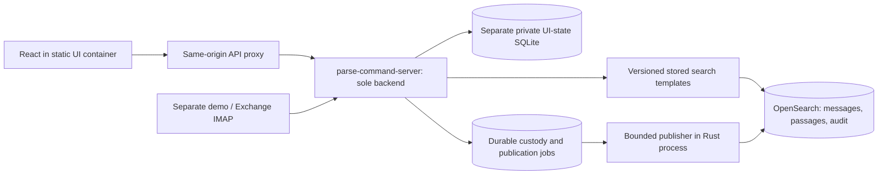

# Proposal: connect Watch Desk to Parse Command

Date: 2026-11-04. Status: approved for one bulk implementation. This document does not
authorize implementation or change the running deployment.

## Recommended decision

Replace the Go runtime with the Rust backend in one bulk change and one
deployment cutover. Keep React in a separate lightweight static UI container that proxies
API/session calls to `parse-command-server` over the internal Compose network.
The final application stack remains three services: `web`, `server`, and
`opensearch`. The demo mail environment remains separate.

Rust owns intake, parsing, durable publication, stored-template execution,
canonical reads, private user state and identity/session endpoints. This gives
one backend owner for the read and write paths. Expected maintenance/runtime
simplification must be verified; do not promise a memory reduction before
measuring the complete replacement.

Preserve the frontend's generated ConnectRPC contract where practical. Include
any necessary contract generation and shared-client updates in the same change,
and test them using the actual browser client before deployment. The browser continues to use one origin and typed requests;
it does not assemble OpenSearch DSL, choose model IDs, join messages/passages or
interpret USMTF records. A common frontend adapter owns any necessary contract
changes.



This proposal supersedes ADR 0001's temporary Go-runtime decision when approved.
Deliver one reviewable change containing the complete Rust replacement, UI
integration, templates, state migration and Compose changes. Go is removed from
the active deployment at that cutover; there is no intermediate Go gateway or
dual-backend rollout. Preserve the original data and image as rollback assets.

## Go responsibilities that must move to Rust

| Existing behavior | Replacement included in the bulk change |
| --- | --- |
| Static React hosting and SPA fallback | Bundled UI assets in a small nonroot static/proxy container; deep links and cache/content headers tested |
| ConnectRPC routing/encoding/errors | Pinned Rust implementation, tested against existing generated TypeScript clients; preserve protobuf JSON timestamp/int64/presence semantics |
| `Health`, `Info`, `GetIdentity`, `ListRoles` | Rust endpoints with equivalent response/error semantics and explicit service/model readiness |
| `ReadSchedules` and structured payload handling | Canonical message/timeline API with central UI mapping and lossless structured JSON |
| `ReadDraft`, `SaveDraft` | Private owner-scoped Rust persistence, preserving unsent behavior |
| `ReadPreparation`, `SavePreparation` | Port structured formatting, validation and generation rules with regression fixtures |
| `RecordAcknowledgement` and activity history | Preserve user-reported occurrence/recording times and confirmation rules; never imply email transmission |
| Mock login/session preflight and identity changes | Compatible local-only session endpoints and session/cache invalidation behavior; preserve owner isolation across switches |
| SQLite/ENT private records | Versioned one-time migration to Rust-owned private schema, with backup, ID/source mapping and rollback |

All currently defined application RPCs are unary. Connect's [protocol reference](https://connectrpc.com/docs/protocol/)
describes the JSON/HTTP contract. Rust support is [documented as pre-1.0](https://connectrpc.com/docs/rust/get-requests-and-caching/),
so dependency selection must verify compiler requirements, supported protocol
features, code generation and failure behavior. Contract/client updates belong
in this same change. Do not hand-edit generated files or assume a partial JSON
route is a compatible Connect server. Compatibility checks are pre-deployment
validation, not a separate delivery phase.

## Current implementation and gaps

- Rust polls IMAP and commits source emails, parsed projections and audit work
  to SQLite custody. Continuous OpenSearch delivery is not implemented.
- OpenSearch currently holds 14 messages, 92 embedded narrative passages and
  665 audit records, loaded through explicit snapshot tools.
- Keyword, semantic and hybrid passage templates already exist and have live
  filter, escaping and offline-inference tests. They return passage hits,
  initially limited to 20; they are not a complete message-list/timeline API.
- Watch Desk's message page, calendar and notifications currently use the
  SQLite-backed `ReadSchedules` snapshot. Its five fictional records are a
  separate dataset.
- Private draft/preparation handlers look up SQLite message rows. Their
  source linkage must be migrated deliberately when canonical messages come
  from OpenSearch.

## Frontend contract

Extend editable protobuf contracts and regenerate the frontend clients through
the documented generation workflow; generate Rust bindings through a pinned,
reproducible build step. Keep bundled Ark framework/pipeline files unchanged. Centralize source access in shared frontend hooks so pages do not
independently repeat mapping and error logic. The following operation names are
proposed; their browser transport preserves same-origin ConnectRPC with any
required binding/client changes included in the bulk implementation.

| Operation | Frontend supplies | Backend returns |
| --- | --- | --- |
| `ListMessages` | Typed filters, bounded page size, opaque page token | Compact message cards, publication/review state, next token |
| `SearchMessages` | Query text, mode, typed filters | Ranked message cards with bounded matched excerpts and parent/revision links |
| `GetMessage` | Canonical message ID and parser revision | Canonical structured record and review metadata |
| `ReadTimeline` | UTC start/end and command selection | Prepared interval/point items plus unresolved/review items |
| `GetMessageEvidence` | Message/revision and optional fact/passage ID | Bounded evidence/source detail, fetched only on demand |
| `GetSourceStatus` | No query DSL | Index/model readiness, publication/enrichment backlog and observation time |

Use an explicit `MessageKey { message_id, revision }`; use revision-scoped fact
IDs for event/evidence links. Do not truncate SHA-256 identities into integers.
Frontend view-model conversion belongs in one adapter; page components receive
display-ready fields and stable keys. Existing private records keep their
legacy identities during migration.

Illustrative application request, before generated-client encoding:

```json
{
  "query": "communications handover",
  "mode": "hybrid",
  "filters": {
    "command_ids": [],
    "message_types": ["OPTASK COMMS"]
  }
}
```

No template ID, model ID, backing-index name, `has_*` flag, vector, score-fusion
setting or raw filter DSL comes from the browser. An empty query uses message
browsing and performs no query inference. Issue-time filters and timeline-window
filters are separate typed fields with separate meanings.

Responses report `requested_mode`, `executed_mode`, `retrieved_at`, relevant
publication/enrichment state and any limiting/degraded condition. A read timestamp
must not stand in for receipt time, issue time or publication time. List/detail
reads do not automatically retrieve raw source, all audit records or vectors.

## Stored template inventory

Keep current passage templates available while introducing the application-facing
generation. Rust maps operation/mode to a fixed template and search pipeline;
templates are installed/versioned by the offline bootstrap, not by the UI.

| Template family | Purpose and behavior |
| --- | --- |
| `parse-command-messages-list-v1` | Core metadata filters; stable deterministic sort; bounded browsing with backend-managed cursor |
| `parse-command-passages-keyword-v2` | BM25 with a bounded candidate window and shared typed metadata restrictions |
| `parse-command-passages-semantic-v2` | Same restrictions, ready embeddings and the pinned local model |
| `parse-command-passages-hybrid-v2` | BM25 plus semantic with the existing RRF search pipeline; restrictions in both branches |
| `parse-command-message-detail-v1` | Exact message/revision lookup; no approximate ID matching |
| `parse-command-timeline-v1` | Nested fact/time predicates against canonical messages; independent of text relevance |
| `parse-command-evidence-list-v1` | Bounded parent/revision audit lookup; backend resolves the requested fact/passage evidence |
| `parse-command-source-status-v1` | Small readiness/enrichment summary without message bodies |

Exact-ID hydration may use a bounded `_mget` rather than a search template where
that is simpler. All executable query construction stays server-side.
Audit payloads remain unindexed. Evidence retrieval filters indexed envelope
fields, pages through a bounded parent/revision result, and selects payload
entries in the backend; it must not pretend `payload.passage_id` is searchable.

For ranked search, retrieve at most 100 passage candidates and group them by the
exact parent/revision in Rust. Hydrate at most 20 canonical messages with bounded
excerpts. Recheck parent existence, revision and access restrictions before
returning results. Drop stale/orphaned hits and report the limitation. This may
produce fewer than 20 distinct messages; it is not a complete message count.

Initial ranked search remains a bounded first-page result, explicitly marked
when the candidate window limits coverage. Do not invent an exhaustive result
count or a reliable ranked pagination token. Message browsing supports an opaque,
short-lived cursor with server-owned sort/PIT details. Ranked pagination can
follow after testing its grouping/candidate semantics against the pinned release.
OpenSearch documents distinct behavior for [hybrid pagination](https://docs.opensearch.org/latest/vector-search/ai-search/hybrid-search/pagination/)
and [collapse with pagination](https://docs.opensearch.org/latest/search-plugins/searching-data/collapse-search/).

## Publication and resilience

Add durable canonical, passage and audit publication jobs to custody without
resetting receipts or mailbox cursors. Enqueue jobs in the transaction that
commits parser results. Resume pending jobs after process/cluster outages.
Backfill the existing 14 projections through this same durable path; manual
fixture loading stops being the live integration mechanism.

Use a bounded publisher, initially one worker, batches of at most 16 documents
and 2 MiB, reusable connections and capped retry/backoff. Check every Bulk item
and acknowledge only successful work. Store target generation/concrete index,
document identity and content checksum so retries cannot silently land in a new
rollover generation or overwrite another revision. Immutable audit conflicts
require source equality. Preserve one audit representation of each source and
do not erase custody as part of backfill.

Publish canonical data independently of embedding readiness. Stage passage text
so keyword retrieval is possible during model outages; retry failed enrichment
with stable IDs. Rust prepares token-bounded passages using the approved local
tokenizer artifact, with parity against the current tested chunker. OpenSearch
continues to perform inference. Python remains a provisioning/test tool rather
than a production service.

Canonical/parsing, passage enrichment and evidence publication have independent
states. OpenSearch writes across these indices are not one transaction. API
responses must preserve missing/pending evidence and incomplete enrichment
instead of claiming atomic completion. An index disappearing is a readiness
failure requiring an explicit replay/recovery path, not proof that previously
acknowledged jobs remain published.

Use configured aliases through a server-owned index manifest. Keep the current
historical fixture profile separate from production expiry. Do not silently
apply issue-time deletion to the test corpus or claim that this integration
implements the complete 90-hot/365-total retention design.

## Timeline and presentation rules

Return ready-to-render timeline items from canonical facts. Only use resolved
absolute instants; interval items require `end > start`. Explicit changeover
instants may be point items without an invented duration. Keep unresolved facts
and unassigned commands visible in review/detail views.

Message validity, an arbitrary frequency entry and a named geographic area are
not automatically scheduled ship events. Parsing success/partial output does
not establish operational confirmation. Preserve review state and distinguish
resolved extraction from operator confirmation in the presentation contract.
Do not infer a ship roster or local C2 assignment from unit mentions. Command
selectors use canonical assignments/approved roster data; unresolved assignments
remain explicit.

The default current-day calendar may correctly be empty for historical samples.
Acceptance testing selects their actual source time windows; it must not move
their dates forward or substitute email receipt time for missing dates. Source
errors never trigger a fallback to the fictional seed.

## Private state and access boundary

Keep drafts, preparations and user-reported acknowledgement activity in a
separate Rust-owned SQLite private-state database/volume. Do not merge private
user state into custody or shared OpenSearch audit records. Add revision-aware
canonical source references without requiring a copied canonical SQLite message
row. Preserve fictional/legacy references and owner isolation; never reattach a
private record because its title or numeric ID matches another source.

Migration runs against a consistent backup of the existing Go database, with
an explicit schema version and recorded source/owner/row mappings. Validate row
counts, draft text, preparation fields/generated text, acknowledgement history,
owner identity and source references before switching. Leave the original volume
intact and prevent concurrent Go/Rust writers against either database. New saves
use canonical keys; old fictional drafts remain accessible in explicit fixture
mode. Rollback must account for new private writes after cutover, not simply
start Go on a stale backup and lose them.

Rust must replace the existing identity and local session behavior deliberately.
The current UI probes `/__ark/mock-whoami` and navigates to `/__ark/mock-login`;
these routes cannot disappear while retaining that UI gate. Preserve the
identity-change/cache-invalidation behavior in both tabs and private-state calls.
Local mock identities remain explicit demo-only configuration.

Canonical and private reads verify the requesting context before serving data.
An arbitrary browser header is not authenticated identity. Command selection
and source classification labels are retrieval fields, not authorization grants.
Operational identity, access policy and Exchange PKI remain separate decisions
before operational source exposure; removing Go does not implicitly replace or
approve the production trust mechanism.

## Failure and resource behavior

- Reuse the current strict error behavior initially: keyword search remains
  available; semantic/hybrid model failures are explicit. A keyword retry is
  an explicit request, with the executed mode shown. No silent downgrade.
- Bound query text, filter counts, request/response bytes, result/candidate
  sizes, audit pages and concurrent inference requests. Start from the current
  240-byte query limit, 20 returned messages and five-second search deadline.
  Propagate cancellation and reject timed-out/partial-shard results.
- Keep polling/publication independent of read/inference saturation. Do not
  load the whole journal/index into RAM or run inference for blank browsing.
- Fetch full source/evidence only when a message is opened. Share bounded client
  query caches and use cancellation/debouncing for search; no full-dataset text
  filtering in the browser. Propose 30-second visible-view refresh and 300 ms
  query debounce as configurable local defaults, with freshness shown.
- Rust API is internal to the Compose application network; the static UI proxy
  exposes the existing loopback browser origin. The demo mail project remains
  separate. Runtime builds/downloads/CDNs/remote inference remain absent.

## One bulk implementation and deployment

Deliver one implementation change/PR containing all of the following together:

- The complete Rust API and replacements for current Go identity/session,
  draft, preparation and acknowledgement behavior.
- Continuous canonical/passage/audit publication with durable retries and
  backfill of existing custody records.
- All application search templates, request validation, message hydration,
  timeline mapping and on-demand source/evidence retrieval.
- Updated frontend contracts, generated bindings and shared hooks, with
  backend-driven searching/filtering and explicit readiness/review displays.
- A static/proxy UI image and Compose configuration with Rust as the sole
  backend. The separate demo environment stays separate.
- A versioned private-state/custody migration, preserved backups and an explicit
  rollback procedure. Retire obsolete Go runtime/build wiring in this same
  change while leaving protected Ark dependencies unchanged.
- Automated contract, browser, migration, outage/replay and offline checks.
  Measure the replacement's resource footprint as part of validation.

These are work packages within one change, not independently deployed phases.
There are no interim production configurations, staged feature rollouts or
additional approval checkpoints between packages.

Build and validate the complete replacement before the single cutover. During
that deployment, stop the old UI/backend writers, take consistent state backups,
run the versioned migrations and apply template/index configuration, then start
the new Rust backend and static UI together. Check service/model/publication
readiness and the browser smoke test before accepting user writes. The inbox
remains in its separate environment and retains mail during the interruption.

If pre-opening checks fail, restore the prior images and consistent backups.
After user writes resume, any rollback must preserve those new private writes
through the documented migration/export procedure; never silently discard them.

## Acceptance criteria

- A new supported email becomes a custody receipt, a canonical indexed message
  and a visible UI message without a manual Python reload. Duplicate-body email
  updates subject/conflict state without creating another canonical message.
- Keyword/semantic/hybrid queries return message cards with matched excerpts;
  all retrieval branches and detail hydration respect the same restrictions.
  The browser sends no DSL, index/model/template selection or join logic.
- Only valid resolved timeline facts enter their appropriate interval/point
  presentation. Historical/unresolved data stays accurately dated/unresolved.
- Every current application RPC and local session flow passes parity tests
  against the Rust replacement. Drafts/preparations survive migration and
  restarts, retain owners and refer to the intended source/revision. Legacy
  fixture records remain separate; rollback preserves post-cutover writes.
- OpenSearch/model failures are visible. Intake retains custody, publication
  resumes after recovery, keyword text survives enrichment failures, and no
  stale snapshot or fictional seed is presented as a successful fresh read.
- Offline restart, item-level Bulk failures, replay, source/passage schema
  conformance, bounded queries and browser journeys pass. Record memory/CPU
  under a representative burst; do not extrapolate capacity from idle usage.

Approval requested: replace the Go runtime with Rust in one bulk change and
one deployment cutover, retain a separate static/proxy UI container,
implement the stored-template families and frontend responsibilities above,
include durable publication/private-state migration, and keep ranked search to
a bounded first page for this initial integration. Implementation has not begun;
only this proposal has been written.

Implementation correction: do not add search-mode or dataset dropdowns to the UI. The user requires asking before making additional user-facing behavior decisions. Existing backend modes remain API capabilities.

Confirmed search decision: always use keyword plus semantic hybrid search with OpenSearch reciprocal rank fusion. The user confirmed this after the unrequested selectors were removed.
