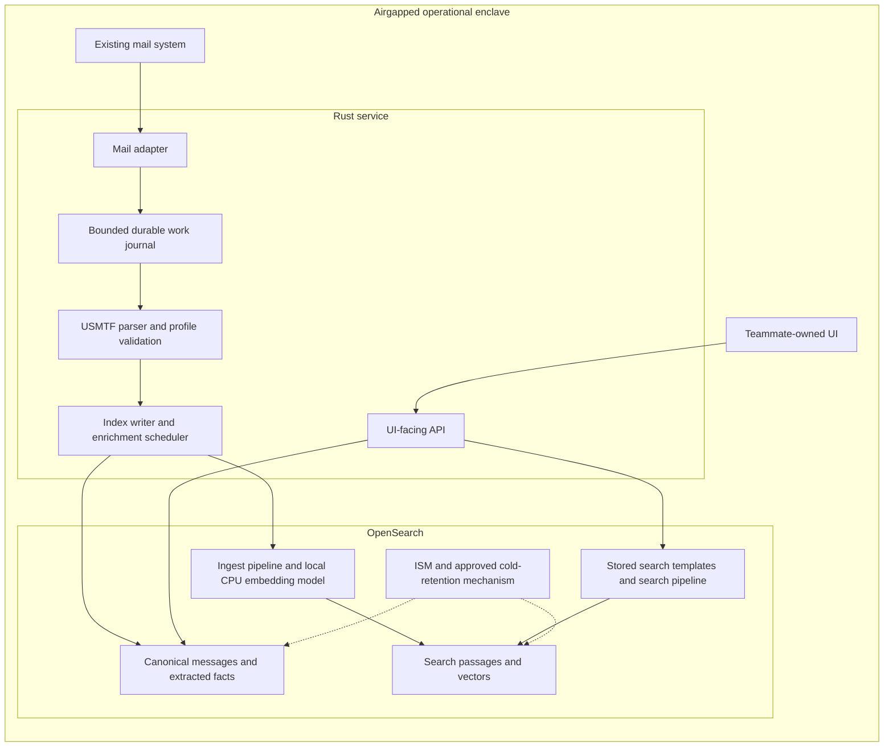

# Parse Command implementation plan

Status: proposed engineering plan, 2026-11-04. No product implementation or deployment has started. Unresolved decisions are tracked in [decisions and questions](decisions-and-questions.md); proposals are not implicit defaults.

## Outcome and boundaries

Deliver the backend of an operational message-to-schedule capability. The two-day milestone is a proof of concept validated with representative traffic and an SME. Initially process OPTASK messages exclusively, covering all agreed variants rather than only COMMS/LINK. The teammate owns the UI; backend contracts and offline integration support are included here.

Confirmed operating envelope: CPU-only laptop-style deployment with no GPU; exact CPU architecture, RAM, and disk are undecided. Expect bursts of hundreds of messages every few hours. Retain data for 365 days total measured from USMTF issue time: first 90 days hot, following 275 days cold and still searchable. Runtime must be entirely airgapped; builds and dependency preparation may use connected infrastructure. Implement IMAP only. Mail TLS is required eventually but may be deferred in v1, per the user. Use the 2003 USMTF baseline and infer additional sets/layouts from later examples where supported by evidence; label those extensions explicitly. Build the parser extension interface first, with team contributions delivered as compiled Rust modules/crates.

## Proposed architecture

The proposed durable journal is embedded SQLite in the Rust container's persistent volume. It does not add a database server. Confirm this choice before implementation. Use one Rust process with bounded worker concurrency, pooled connections, and isolated blocking work. Keep inference in OpenSearch as requested; do not introduce a separate inference server or cloud connector.

OpenSearch node count is an availability/budget decision. A proposed single-node laptop profile offers process restart recovery, not continued service after loss of its only host or disk. Define recovery objectives before claiming operational resilience.

## 0. First build milestone: extensible parser server interface

Implement the [parser extension contract](parser-extension-interface.md), host registry, shared USMTF record/source types, contributor guide, and conformance harness before email/OpenSearch integration. Other teams contribute compiled Rust modules/crates that implement message-specific interpretation through the same contract.

Keep transport decoding, queue/storage clients, local inference, and HTTP concerns outside parser modules. Propose a common pure parsing interface with borrowed input and bounded output; choose final Rust signatures during interface review. Exact message/profile dispatch must detect conflicts instead of depending on registration order. Preserve unknown types and partially understood content.

Use a test-only independently authored reference parser to prove extension without changing intake or storage. Initial production-enabled message types remain OPTASK. Publish common serialized results early so the UI teammate and parser contributors work against compatible contracts.

**Gate 0:** A second parser registers, runs, and passes the common harness without host transport/storage changes. Version compatibility, deterministic dispatch, source spans, error states, and resource bounds are demonstrated. Compiled parsers are reviewed code within the host process, not a runtime security sandbox.

## 1. Establish the acceptance corpus and compatibility contract

1. Use the confirmed 2003 baseline, inventory all supplied OPTASK types, and define evidence-backed later-example extension profiles. Confirm any additional operational variants and mail packaging.
2. Use the fourteen supplied text examples as initial fixture candidates; preserve their identities/hashes and inspect differences from the PDF examples.
3. Obtain SME-approved expected results for every type: metadata, ordered records, applicability, POCs, temporal facts, and diagnostics.
4. Add representative frequency-plan, crypto change-over, explicit flight-quarters, amendment/cancellation, and malformed-input cases. Generic sample prose does not validate operational extraction.
5. Separate structural coverage, semantic extraction coverage, and operational acceptance in a visible matrix. Unknown records must remain accessible.
6. Agree numeric accuracy, latency, memory, outage, and recovery targets once hardware and traffic details are available. Record measurements rather than inventing passing thresholds.

**Gate A:** Each positional semantic mapping has a cited 2003 definition, an evidence-backed inferred extension rule with a regression fixture, or an explicitly SME-approved rule. The user has authorized inference from later examples. Record inference provenance, observed layout/signature, limitations, and unresolved alternatives. Sparse or contradictory evidence remains unresolved. Missing definitions limit compliance claims, not permission to implement well-supported extensions.

## 2. Freeze the teammate integration boundary early

Review the [UI contract proposal](ui-integration-contract.md) with the teammate before backend implementation. Agree message/event identifiers, source-span representation, time resolution states, command/POC evidence, filtering, pagination, search modes, and health/degraded behavior. Define the 24-hour window and display-zone behavior explicitly.

Prepare an OpenAPI contract and representative JSON fixtures during implementation after these decisions. Include unresolved times and enrichment-pending messages in fixtures. The UI must never have to infer certainty from the presence of a formatted date string.

**Gate B:** The teammate can build against agreed response fixtures while Rust/OpenSearch work proceeds. UI implementation remains with the teammate.

## 3. Design and implement durable email intake

### Adapter decision

Implement IMAP only. Persist account/mailbox identity, UIDVALIDITY, and UID; do not use transient message sequence numbers as durable cursors. On UIDVALIDITY change, use the agreed rescan/deduplication policy. Authentication, poll interval, initial mailbox scan, and MIME packaging remain decisions. POP3 implementation is outside v1 scope.

V1 may omit mail TLS per user direction. Make that an explicit configuration mode; preserve a transport abstraction that can add verified TLS, local trust roots, and the agreed authentication mechanism. Other API/OpenSearch transport security requirements remain to be decided.

### Durable acceptance and work state

Proposed work flow:

`received -> durably staged -> decoded -> parsed -> canonical indexed -> passages pending -> complete`

Record retryable failures, quarantined items, and intentionally unsupported content as explicit states. Stage source bytes and receipt identity durably before advancing the durable intake cursor or issuing any acknowledgment that could remove access to the source. A malformed payload must not cause an infinite fetch loop or prevent subsequent traffic from progressing.

For an embedded journal, use transactions and an explicit durability mode; verify behavior under abrupt termination. Prefer one bounded storage path for raw payload and job metadata to avoid an uncoordinated file/database commit. Run blocking database operations outside async runtime threads. If file spooling is chosen instead, specify fsync/rename/directory durability and orphan reconciliation.

Use at-least-once work delivery with idempotent effects. Separate receipt identity, raw-content fingerprint, logical USMTF identity, and revision identity. Internet `Message-ID` alone is not a reliable uniqueness contract. Duplicate deliveries may produce multiple receipts but must not duplicate schedule facts. Different bytes with the same logical identifier must not silently overwrite one another.

### Bounds and backpressure

Configure limits for fetched headers/body bytes, MIME nesting/parts, decoded bytes, attachment count, number of USMTF messages per email, raw queue bytes, queued jobs, retry age/attempts, and quarantine bytes. Select values from representative data and the resource budget.

When intake cannot durably accept data, stop fetching/advancing rather than acknowledging and dropping it. Ensure poison-item recovery, low-disk behavior, queue saturation, and mailbox reconnect behavior are observable. Do not automatically delete messages from the upstream mailbox; agree the policy first.

**Gate C:** Restart at each processing boundary and replay duplicate deliveries. No acknowledged accepted payload is lost within the agreed failure model; no duplicate operational facts are created.

## 4. Implement the format-aware OPTASK parser

Use [USMTF foundations](../knowledge/usmtf-foundations.md), [coverage](../knowledge/optask-coverage.md), and [time/command notes](../knowledge/time-and-command-interpretation.md) as the starting knowledge base.

1. Preserve original decoded text and provenance; explicitly map any normalization.
2. Build a bounded scanner with distinct formatted, columnar, and free-text states. Handle wrapped fields, `://`, terminator-only lines, descriptors, hyphens, and repeated field groups.
3. Produce ordered record occurrences with field values, spans, line ranges, and segment paths. Preserve unknown sets and fields without treating prose continuation lines as sets.
4. Select the 2003 profile or an evidence-backed extension profile using message type, available edition/version evidence, and validated layout/signature checks. Preserve the message's declared version rather than rewriting it to 2003. Mark inferred rule provenance explicitly; do not silently force the 2003 layout onto later examples or apply a later offset to an older record. Ambiguous layouts remain unresolved.
5. Apply message ordering, required/conditional field rules, segment repetition, and field-format checks for implemented profiles. Do not claim full structural-notation language support merely because selected rules are implemented.
6. Extract frequency facts with original precision and units; use checked decimal/scaled representations where feasible. Frequency/channel/designator fields are not interchangeable.
7. Extract temporal facts with their semantic purpose, precision, qualifier, recurrence evidence, and resolution status. Do not use the host's current date to fill absent context.
8. Resolve command applicability using the approved local identity/group policy; keep mentioned/reference entities separate.
9. Preserve source POCs and independently apply approved local C2 routing. Missing or contradictory routing remains explicit.
10. Model cancellation and amendments only after SME-approved identity/precedence rules are established. Preserve lineage and out-of-order evidence.

Proposed sequencing within all-type coverage: shared grammar and metadata; COMMS/LINK frequency/crypto cases; RAS/GENERAL coordination and schedule cases; remaining variants. All agreed types remain in the completion gate.

Code defensively: bounded iteration/nesting, checked lengths and arithmetic, fallible conversions, no user-input-triggered panic paths, no unbounded regex work, typed errors with redacted context, and deterministic parser output. Test parser memory behavior as well as correctness.

**Gate D:** Every agreed type passes labeled structural and semantic tests at its declared support level. Required extraction capabilities, including flight quarters, have explicit validation examples. Unsupported or ambiguous content is visible rather than fabricated.

## 5. Establish OpenSearch persistence and configurable retention

Propose canonical message documents plus derived search-passage documents; avoid an index per command or message. Decide primary/replica counts and rollover granularity after measuring shard overhead and availability needs.

Core message documents contain only display/query metadata, security markings, typed periods/frequencies/activities/contacts, command applicability fields, and small user-visible review states. Core passage documents contain text/vectors and the metadata needed for hybrid filtering. Move source text, ordered records, byte spans, field positions, parser/profile detail, inference evidence and detailed diagnostics to a separate OpenSearch audit index, as directed by the user. Link through message ID + revision + short subject ID; preserve original source once in audit. Select nested mappings only for fact tuples that need associated conditions, not raw audit objects. The current populated proposal is in [the compact JSON review](../review/json-structure/README.md).

Stage audit events and core write intents durably in the same journal transaction. A bounded audit worker sends Bulk requests by configurable count/byte/age limits; inspect and acknowledge each item, retry transient failures, retain permanent failures for operator action, and replay with stable event IDs/concrete backing-index targets. Core visibility may precede the audit flush once intent is durable. Audit payload contents remain stored but unindexed (`enabled: false`); index only lookup/time/type/security fields. Bound audit backlog and apply intake backpressure before disk capacity is exceeded. Separate indexing still incurs resource/storage overhead and must be included in the resource budget. Audit retention and source-evidence cleanup order remain decisions.

Persist canonical parsed messages before requiring embeddings. A model outage must not erase accepted messages or hide already validated timeline facts. Passage enrichment has its own status and retry state. Partial bulk indexing requires per-item acknowledgment and replay; an HTTP 200 bulk response is not a guarantee that every item succeeded.

Persist each write's concrete backing index/partition, deterministic ID, parent/revision ID, and schema generation. Resolve retries across rollover and retention explicitly. OpenSearch does not give the application an atomic transaction spanning canonical documents and passages.

Use OpenSearch ISM for 365 days total retention measured from USMTF issue time: hot before age 90 days, searchable cold from age 90 until age 365 days, then expiration under the agreed cutoff policy. Index-level cutoff granularity remains open. Cold must stay searchable, including the configured keyword/semantic/hybrid modes; a snapshot requiring manual restore does not satisfy this requirement.

Partition or coordinate lifecycle using verified issue-time evidence, not index creation time or receipt time. Late arrivals already in the cold age range must target the corresponding policy/state. Do not reset a message's age by replaying, reindexing, or receiving a duplicate. The policy for missing, ambiguous, invalid, or implausibly future issue time remains open; do not silently substitute receipt time. The 2003 MSGID does not itself supply a full issue timestamp, so inspect envelope/transport DTG evidence and document the accepted source. Explicitly test late arrivals beyond retention and late writes into sealed indices.

Proposed laptop implementation: keep older sealed indices open and searchable, apply a read-only/appropriate-priority policy through ISM, and retain their message and vector mappings. This is a logical cold state on existing storage, not a claimed physical tier or automatic memory/disk saving. Before sealing, account for delayed passage enrichment, replay writes, and any approved revision/control updates; persist concrete write targets so read-only transitions cannot strand accepted work. Index granularity and write-completion rules need agreement.

OpenSearch also supports node-attribute allocation and searchable snapshots, but those require deliberate topology/repository choices and version compatibility checks. They are alternatives to evaluate if the budget requires separate storage. Do not add a cold node or repository service implicitly. See the [tiering notes](../knowledge/opensearch-airgap.md#searchable-cold-is-not-a-product-name).

Coordinate parent/passages, journal payloads, quarantine, logs, snapshots, and replay tombstones. Decide how still-effective or open-ended orders are treated at retention boundaries. Agree the retention clock and deletion granularity; index deletion is not exact per-record TTL.

**Gate E:** Policy/config changes are validated before application. A shortened-clock test proves rollover, the 90-day logical boundary, the 365-day total boundary, keyword/semantic/hybrid retrieval across hot and cold data without manual restore, late-write handling, parent/passage consistency, and prevention of expired-data resurrection. Report index-level scheduling/cutoff granularity explicitly.

## 6. Package and validate local embedding inference

After CPU architecture and budget are known, select an approved small CPU model through measured compatibility/resource/relevance tests. Pin OpenSearch, plugins, model archive, tokenizer, native engine/JNI libraries, model configuration, vector dimension, and distance metric. No GPU requirement or GPU-only build is acceptable.

Use a local artifact registration path supported by the selected release. If an internal temporary artifact endpoint is needed, keep it inside the deployment boundary and remove it after registration. Do not substitute an external connector or public pretrained-model fetch. Check checksums and bootstrap task completion.

Implement bounded message/segment-aware passage preparation and token-aware oversize handling. Ingest pipelines generate vectors locally. Query embedding uses the same model space and compatible preprocessing. Store model and chunker revisions for repeatable reprocessing.

Limit indexing batches and model concurrency independently of mail polling. Include JVM heap, native inference allocations, vector index/native memory, page cache, and concurrent API work in the memory budget. Keep ML circuit breakers enabled. Prove model deployment/redeployment after restart before advertising semantic readiness.

**Gate F:** Clean offline first start, model registration, actual ingest simulation, actual inference, long-message tail retrieval, and restart recovery work within the agreed resource cap. Pipeline creation alone is insufficient.

## 7. Implement stored search templates and bounded API queries

Provide versioned stored templates for lexical, semantic, and hybrid search. The hybrid template combines BM25 with the local semantic clause and the selected search-pipeline rank combination. Select weighting/fusion and candidate counts using labeled queries, not arbitrary constants.

Apply command/time/type/marking access restrictions consistently to lexical and semantic retrieval. Validate filter placement against the selected version and ANN strategy. Ensure a query for one command cannot retrieve unauthorized passages from another branch of a hybrid query.

Search results identify parent message/revision, matched passage, source spans, and ranking mode. Bound query bytes, result size, candidate count, timeout, concurrent searches, pagination state, and returned source payload. Avoid unbounded deep offsets and arbitrary user-provided DSL or scripts. Decide parent-message deduplication, overfetch limits, and cursor semantics with the UI teammate.

Proposed degraded behavior: lexical passage search remains available when vector inference is unavailable, with an explicit response mode and reason. Persist passage text independently of embedding success and enrich the same stable passage later. Semantic-only requests either fail clearly or follow a separately agreed policy; do not silently claim semantic ranking. Schedule retrieval must not depend on vector relevance scores. Core search never requires querying the audit evidence payload.

**Gate G:** SME-labeled exact identifiers and conceptual queries return the expected evidence; every query branch obeys filters; unsupported search modes and timeouts are visible and bounded.

## 8. Assemble and verify the airgapped Compose deployment

Use prebuilt digest-pinned images, persistent journal/OpenSearch volumes, explicit CPU/memory/PID limits, bounded logging, healthchecks, restart settings, graceful shutdown, local secrets, and the agreed TLS/auth controls. Avoid privileged containers, Docker socket mounts, unnecessary host port exposure, and runtime package installation.

Separate mail connectivity from the private search network. Only approved in-enclave mail, client, DNS, time, and PKI paths may be required. Define the host/enclave egress controls; Compose alone does not prove an airgap. The UI must package fonts, scripts, styles, and other assets locally.

Bootstrap must be repeatable and version-aware: validate configuration -> wait for authenticated OpenSearch -> apply mappings/ISM -> register/deploy model -> simulate ingest -> install pipelines/templates -> verify readiness. Preserve completed state; do not blindly recreate data or redownload assets on restart.

Distinguish process liveness, intake capacity, canonical persistence readiness, and semantic-search readiness. OpenSearch downtime should pause writers while allowing bounded durable intake until capacity is exhausted, rather than causing a restart loop. Report queue depth/bytes/age, parse failures, indexing errors, enrichment backlog, memory pressure, disk headroom, and last successful mail contact without logging sensitive message bodies.

**Gate H:** Block Internet access before a clean first start. Load local images/artifacts and verify startup, ingest, search, restart, and approved cold recovery. Measure attempted external traffic and fail acceptance if any operational dependency requires it.

## 9. Resource budget and resilience validation

No numeric capacity guarantee is possible until the target laptop is specified. Use actual target hardware, or explicitly identified test hardware, and report both steady-state and peak values.

Budget total memory as host reserve + Rust RSS + OpenSearch heap + native inference/vector allocations + filesystem cache + any UI allocation. Container limits alone do not describe all shared-host pressure. Budget peak disk as hot indices + cold data + journal/quarantine + logs + model assets + snapshot/reindex temporary space.

Measure cold startup/model load, idle footprint, burst processing, maximum-sized input, concurrent search plus ingestion, and restart/backlog recovery. Derive queue storage from peak ingress bytes times tolerated downstream outage plus staging overhead; do not size only by message count.

| Failure or limit | Required planned behavior | Validation |
| --- | --- | --- |
| Mail disconnect or duplicate delivery | Reconnect with bounded backoff; durable identity and idempotent processing | Interrupt sessions and replay identical/differing receipts |
| Crash after fetch/stage/parse/write | Resume from durable state without lost accepted payload or duplicated facts | Terminate at each boundary and restart |
| Malformed/oversize/MIME nesting input | Bounded rejection/quarantine and continued progress | Adversarial corpus and parser fuzzing |
| OpenSearch unavailable/429/partial bulk | Persist pending work; retry only retryable items with bounded jitter/backoff | Stop service and inject partial failures |
| Audit bulk partial failure or crash before flush | Replay durable audit entries; stable IDs and per-item acknowledgment prevent logical duplication; bounded backlog drives backpressure | Fail selected audit items, terminate before/after acknowledgment, and verify complete evidence recovery |
| Embedding model unavailable or out of budget | Retain canonical facts; visible enrichment failure/backlog; agreed search fallback | Undeploy model and trigger bounded resource failures |
| Queue/disk capacity reached | Stop durable acceptance/cursor advancement; visible capacity state | Constrain volumes and fill within an isolated test |
| Rollover during retry | Same operation targets the same durable partition/identity | Roll over between write attempts |
| Retention during delayed replay | No resurrection or orphaned searchable passages | Replay expired operation and verify policy |
| Cancellation/amendment arrives out of order | Preserve lineage; apply only the approved precedence rule | SME-labeled reordered fixtures |
| Host/disk loss | Recover only to the agreed snapshot/source replay guarantee | Restore into a clean deployment |

## Two-day execution sequence after design decisions

Work packages are dependency-ordered, not a claim that unresolved specification gaps fit automatically into two days. UI work proceeds with the teammate against the agreed contract.

| Window | Backend outcome | Exit evidence |
| --- | --- | --- |
| Day 1, opening | Resolve remaining interface questions; freeze parser contribution contract, corpus, UI types, version/model candidates | Recorded decisions and labeled fixtures; no unknown silently converted into a default |
| Day 1, first build block | Parser host/interface, compiled registry, common USMTF types, contributor guide and test harness | Gate 0: a second fixture parser integrates without host transport/storage changes |
| Day 1, second build block | OPTASK implementations, IMAP intake/journal and canonical persistence; lifecycle configuration | All-type source-preserving records, required typed facts, duplicate/restart tests |
| Day 1, integration gate | Local CPU embedding model deployed and tested under constrained resources | Actual vector generation and offline model redeployment evidence |
| Day 2, first build block | Passage processing, search templates, hybrid pipeline, bounded API | Labeled searches, long-message tail retrieval, UI contract compatibility |
| Day 2, second build block | Compose bundle, retention/cold behavior, outage/replay handling | Offline first start and failure-matrix results |
| Day 2, final gate | Full all-OPTASK validation with SME and teammate; resource measurement and runbook | Accepted cases, measured limits, known gaps, reproducible offline handoff |

Treat absent format definitions, inability to load the model within budget, or a missing required extraction case as a visible milestone risk immediately. Any scope change requires an explicit user decision.

## Planned implementation artifacts

- Parser interface crate/modules, explicit compiled registry, shared result types, contributor guide, reference parser, and conformance harness as the first implementation deliverables.
- Rust crate/modules for configuration, IMAP adapter, durable journal, MIME framing, USMTF grammar/profiles, typed extraction, OpenSearch writer, API, and health/metrics.
- Versioned format profiles and an evidence-linked OPTASK coverage matrix.
- Labeled fixtures, parser fuzz targets, crash/replay integration tests, search evaluation cases, lifecycle and offline acceptance tests.
- OpenSearch mappings, ISM policies, local model manifest, ingest/search pipelines, and stored search templates.
- Agreed OpenAPI schema and JSON fixtures for the UI teammate.
- Dockerfiles, Compose configuration, offline export/import manifest, bootstrap tooling, operating/recovery runbook, and measured resource report.

These are future execution deliverables. This planning turn creates only Markdown knowledge and design documents.
